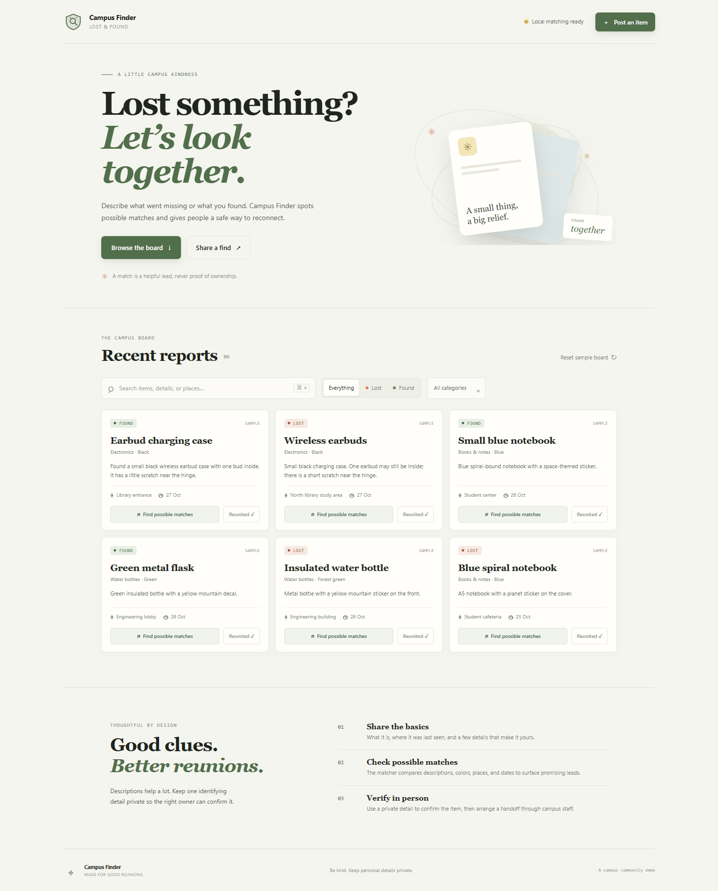
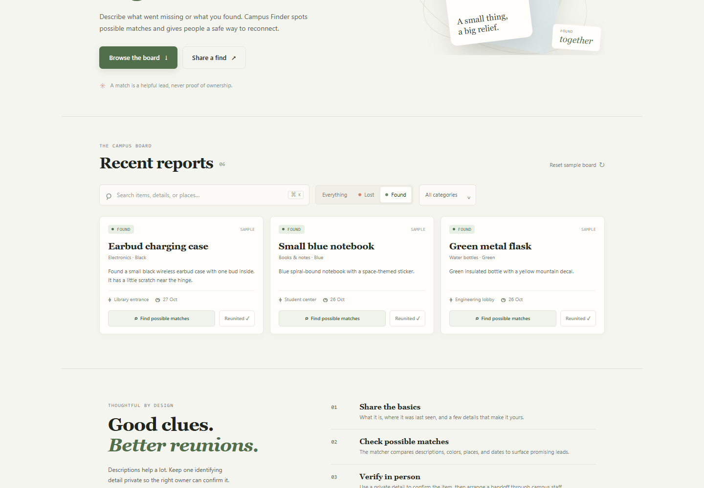
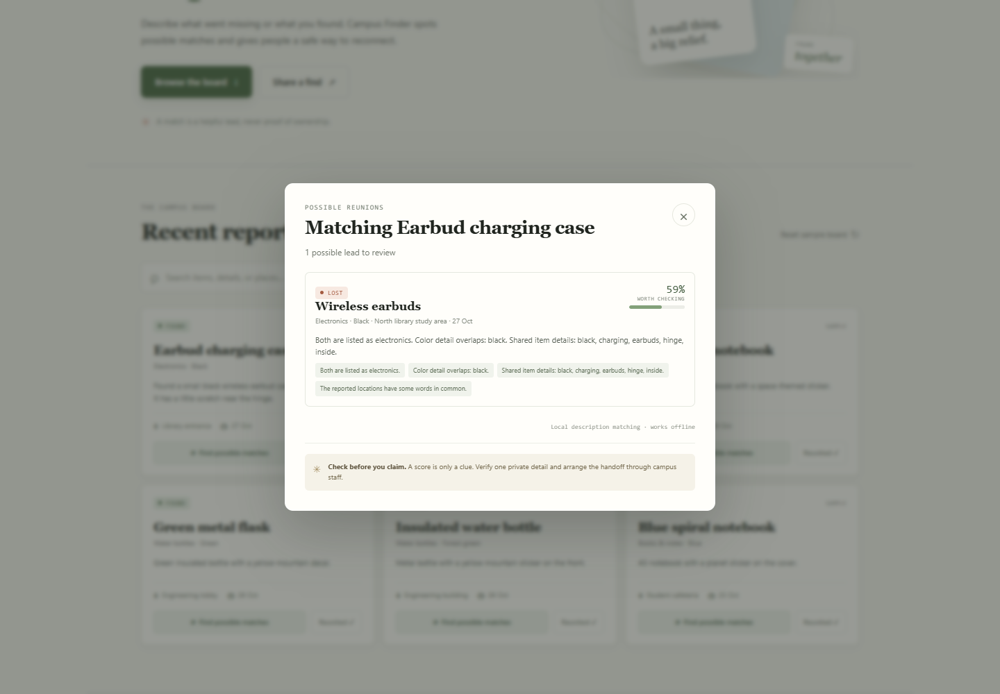
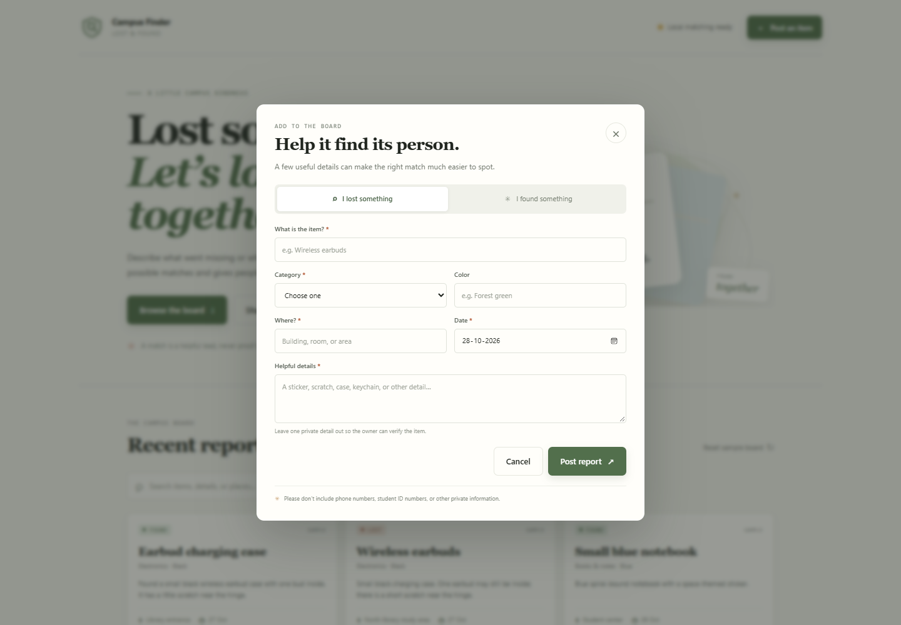

# Campus Finder — Lost & Found

Campus Finder is a small campus lost-and-found board. Students can post lost or found items, search the board, and see ranked possible matches based on item descriptions, colors, categories, dates, and locations.

## Features

- Post a lost or found item with useful identifying details.
- Search and filter the active board by report type and category.
- Request ranked possible matches with reasons and supporting clues.
- Use Gemini semantic matching when an API key is configured.
- Keep matching available offline with the built-in local scoring fallback.
- Mark listings as reunited so they leave the active board.
- Store reports in a local SQLite database.
- Start with sample listings that demonstrate three possible item pairs.
- Keep contact details off the public listing and prompt people to verify a private detail before arranging a handoff.

## Run locally

Requires Python 3.10 or newer. The app uses only Python's standard library.

1. Open a terminal in the project directory.
2. Run:

   ~~~powershell
   python app.py
   ~~~

3. Open http://127.0.0.1:8000 in a browser.

The first run creates a local SQLite database in the data directory and adds sample listings. Reports stay on this computer.

## Enable Gemini matching

Gemini is optional. The app remains usable without an API key, but the local fallback uses text and metadata overlap rather than a language model.

1. Copy .env.example to .env.
2. Add your Google AI Studio key as the value of GEMINI_API_KEY.
3. Restart the app.

The server sends only the item name, category, color, description, location, and date to Gemini. It requests stateless interactions with storage disabled and does not collect contact information. You can change the model with GEMINI_MODEL.

The integration uses Gemini's Interactions API. See the [official API overview](https://ai.google.dev/gemini-api/docs/interactions-overview).

## How matching works

When someone requests a match, the app compares the report against active items of the opposite kind.

- The local score combines name and description overlap, color, category, location, and date proximity.
- With a Gemini key, Gemini ranks candidates and provides evidence-based reasons. The displayed score blends the model's relevance score with the local score.
- Match scores are leads, not proof of ownership. The app asks people to verify a private identifying detail before claiming an item.
- If the model is unavailable or returns an invalid response, the app falls back to local matching.

## Project files

- app.py — local HTTP server, SQLite persistence, validation, matching, and Gemini API integration.
- static/index.html — app structure and forms.
- static/styles.css — responsive visual design.
- static/app.js — board filters, submission flow, and match results.
- development log.md — AI tools, prompts, implementation notes, and lessons.
- requirements.txt — confirms that no third-party Python packages are required.

## Demo walkthrough

1. Show the sample board and the Lost / Found filters.
2. Open the wireless earbuds report and request possible matches.
3. Explain the shared item details and why a score is only a lead.
4. Post a new sample report and show it appear on the board.
5. Mark a listing as reunited.
6. Explain the optional Gemini integration and local fallback.

## Submission media

- [Captioned demo video (WebM, about 24 seconds)](demo/campus-finder-demo.webm)
- Full board: 
- Found filter: 
- Match results: 
- Report form: 

## Scope and privacy

This is a local prototype with no login or user accounts. Keep real contact information and sensitive identifiers out of item descriptions. Before hosting it for a campus community, add authentication, moderation, access controls, and a campus-approved handoff process.
